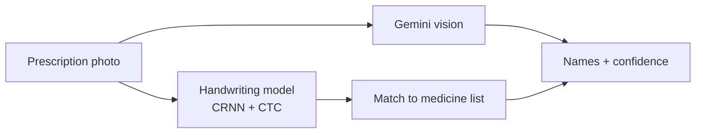

### In 20 seconds

| | |
| --- | --- |
| **What I do** | Build practical AI and web tools, and design the visuals and content that explain them |
| **Built so far** | A blood donor website, a handwritten prescription reader, a World Cup match-reminder app, and an AI-generated face detector |
| **Experience** | 4+ years of remote work for Web3 teams: Poolz Finance, Node Monster, Mind AI |
| **Education** | BSc in Computer Science & Engineering, East Delta University (final year) · Diploma in Computer Technology |
| **Languages** | Bengali (native) · English · Hindi · Urdu |
| **Reach me** | [LinkedIn](https://www.linkedin.com/in/armanspov) |

### Selected work

<b>How each project works</b> (click to open)

 

**DeFakeNet-Lite** · my BSc thesis. A published 2025 model reached 91.95% at telling real faces from StyleGAN fakes. I rebuilt it, found that its heavy image augmentation was the main thing holding it back, fixed the training recipe, and swapped in a much lighter backbone. Result: 98.75% with 1.9M parameters instead of 25.7M, averaged over 3 runs. [Read the full write-up](https://github.com/Armanbro007/DeFakeNet-Lite)

**Prescription Digitizer** · a team project. It turns photos of handwritten Bangladeshi prescriptions into typed medicine names with a confidence score, a PDF export and a safety warning, so a pharmacist confirms instead of guessing. [See the pipeline](https://github.com/Armanbro007/DOCTORPR)

**Khela Calendar** · Pick your favourite teams or matches on the website and tap Add to calendar, on Android or iPhone. Every match lands in your phone's calendar at the correct kickoff time for wherever you are, so the calendar's reminders and widgets pop up on time. No more time-zone mix-ups or missed matches. Works in Bangla or English. [Open the app](https://khela-calendar.vercel.app)

**BloodMate** · my first full website: donor sign-up with blood group, a news feed, login and contact pages, built with HTML, CSS, Bootstrap and JavaScript. [See the code](https://github.com/Armanbro007/blood)

### Tools I use

**AI and data:** Python · TensorFlow / Keras · scikit-learn · OpenCV · LLM APIs (Gemini)
**Web:** HTML · CSS · JavaScript · Bootstrap · PHP · MySQL · Streamlit · Vercel · Git
**Design and video:** Figma · Adobe Premiere Pro · After Effects · Photoshop · Canva

Every graphic on this page is hand-made for this profile and follows your light or dark theme.
