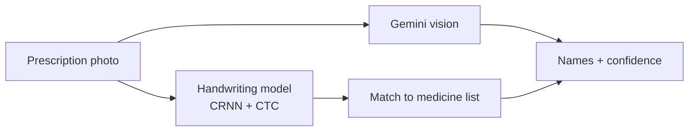

### In 20 seconds

| | |
| --- | --- |
| **What I do** | Build practical AI and web tools, from a research model to an app people can use |
| **Built so far** | An AI-generated face detector, a handwritten prescription reader, and a World Cup calendar app |
| **Education** | BSc in Computer Science & Engineering (final year), East Delta University, Chattogram |
| **Languages** | Bengali (native) · English |
| **Reach me** | [LinkedIn](https://www.linkedin.com/in/armanspov) |

### Selected work

<b>How each project works</b> (click to open)

 

**DeFakeNet-Lite** · my BSc thesis. A published 2025 model reached 91.95% at telling real faces from StyleGAN fakes. I rebuilt it, found that its heavy image augmentation was the main thing holding it back, fixed the training recipe, and swapped in a much lighter backbone. Result: 98.75% with 1.9M parameters instead of 25.7M, averaged over 3 runs. [Read the full write-up](https://github.com/Armanbro007/DeFakeNet-Lite)

**Prescription Digitizer** · turns photos of handwritten Bangladeshi prescriptions into typed medicine names, with a confidence score and a safety warning so a pharmacist confirms instead of guessing. [See the pipeline](https://github.com/Armanbro007/DOCTORPR)

**Khela Calendar** · World Cup 2026 is played in North America, so most matches fall at night in Bangladesh. This app shows all 104 matches in Bangladesh time and creates a calendar feed you subscribe to once, in Bangla or English. [See the app](https://github.com/Armanbro007/khela-calendar)

### Tools I use

**AI and data:** Python · TensorFlow / Keras · scikit-learn · OpenCV · LLM APIs (Gemini)
**Apps and shipping:** Streamlit · JavaScript · Vercel · Git

Every graphic on this page is hand-made for this profile and follows your light or dark theme.
