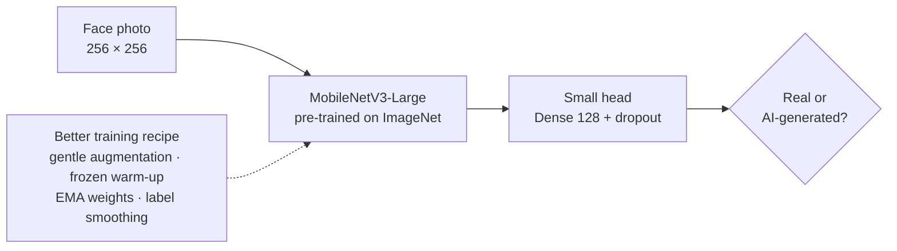

### In 20 seconds

| | |
| --- | --- |
| **Looking for** | Werkstudent / working-student roles in AI and automation, alongside my MSc in Germany (2027) |
| **Strongest work** | [DeFakeNet-Lite](https://github.com/Armanbro007/DeFakeNet-Lite): beat a published deepfake detector with a model 13.5× smaller |
| **Good at** | Taking an AI idea from paper to something people can use, then measuring it honestly |
| **Languages** | Bengali (native) · English (professional working) · German (learning) |
| **Reach me** | [LinkedIn](https://www.linkedin.com/in/armanspov) |

 

<b>How DeFakeNet-Lite works</b> (click to open)

 

The published model got 91.95%. I rebuilt it from the paper, found that its heavy image augmentation was the main thing holding it back (−3.85 points, McNemar p < 0.001), fixed the recipe, then swapped in a backbone 13.5× smaller. Every number is the mean of 3 runs, and the notebooks are saved with their outputs so anyone can check them.

It also has a known limit, written up in the repo: it catches StyleGAN faces almost perfectly, but not faces from diffusion models like Stable Diffusion XL.

### Projects

### Tools I use

**AI and data:** Python · TensorFlow / Keras · scikit-learn · Kaggle GPUs · LLM APIs (Gemini, OpenAI)
**Building and shipping:** Streamlit · JavaScript · Vercel · Git
**Learning now:** n8n and workflow automation · German

Every graphic on this page was designed by hand for this profile and follows your light or dark theme.
